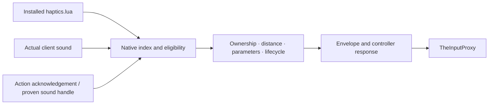

<div align="center">

# DST Haptics Compatibility

**Reconnect native haptic events to your controller.**

[简体中文](README.md) · English

[](https://github.com/Wuty-zju/dst-haptics-compatibility/releases/latest)
[](https://github.com/Wuty-zju/dst-haptics-compatibility/actions/workflows/ci.yml)
[](https://steamcommunity.com/sharedfiles/filedetails/?id=3805091756)
[](LICENSE)

[Install](#installation) · [Features](#features) · [Settings](#settings) · [Architecture](#how-it-works) · [Documentation](docs/INDEX.md)

</div>

A client-only rumble compatibility mod for **Don't Starve Together on Windows**.
It reads the installed game's `haptics.lua` and routes observable native sounds and
audited action feedback through `TheInputProxy`. Servers and other players need no mod.

> **GitHub stable: [1.6.1](https://github.com/Wuty-zju/dst-haptics-compatibility/releases/tag/v1.6.1).**
> Checked against DST 762172 / Steam build 26474873: 506 definitions, 503 unique events.
> Workshop updates are separate: publishing a GitHub release does not update Steam.

## Features

| Area | Behavior |
|---|---|
| Native events | A startup index preserves category, player_only and relative intensity without copying a fixed event list. |
| Tools | Real sounds and acknowledged actions support chopping, mining, hammering and digging; cancelled/replaced actions expire. |
| Combat and danger | Observable native swing, impact and hurt sounds are retained. Melee and hurt approximations are separate, OFF by default. |
| Boss and environment | Observable sounds follow listener-relative falloff. New beam observers read actual named handles, never guessed animations. |
| Sustained sounds | Volume, parameters, replacement, stop and entity lifetime are tracked, including audited weather loops without _LP suffixes. |
| Controllers and tuning | Xbox/XInput, DS4 and DualSense share event semantics, with live intensity/duration, response and spatial controls. |

An event existing in the native table does not prove that a remote client can observe
its producer. See the [1.6.0 trigger-path audit](docs/audit/1.6.0-trigger-paths.md)
for all 14 newly defined events and their boundaries.

1.6.1 maintains existing behavior: it fixes world/player/beam/pause-setting ownership
across reloads and releases removed-entity references promptly. Settings and strict
defaults are retained. See the [1.6.1 review](docs/reports/1.6.1-review.md) for findings,
retained design choices and validation limits.

## Installation

### Steam Workshop

1. Open the [Workshop item](https://steamcommunity.com/sharedfiles/filedetails/?id=3805091756) and subscribe.
2. Enable the mod under DST's client mods.
3. Enable the game's **Controller Vibration** setting.

Move any manual copy out of the game's `mods` folder before using the subscribed copy.

### Manual

Download the named `dst_haptics_compat-<version>.zip` and matching `.sha256`
from [GitHub Releases](https://github.com/Wuty-zju/dst-haptics-compatibility/releases/latest),
verify the checksum, and extract:

```text
Don't Starve Together/
└── mods/
    └── dst_haptics_compat/
        ├── modinfo.lua
        ├── modmain.lua
        └── scripts/
```

Use the packaged asset rather than GitHub's automatic source archive.
For uploading from another computer, see [Workshop distribution](docs/STEAM_WORKSHOP.md).

## Settings

In a world, press **F8** or use the haptics shortcut shown at the bottom of the
controller pause menu. Saved settings apply in about half a second, including while paused.

| Option | Default | Purpose |
|---|---|---|
| Compatibility | ON | Gates compatibility output together with the game's vibration switch. |
| Output mode | Compatibility | Compatibility, Native or no-motor Diagnostic; native and compatibility outputs are exclusive. |
| Language | Chinese | Live prompts/logs switch immediately; configuration labels remain bilingual. |
| Intensity and duration | 100% | Global/category axes from 0% to 200%, in 5% steps. |
| Controller and response | Auto / Detail | Auto or forced Xbox, DS4, DS5; soft, punchy or generic response. |
| Melee / hurt approximations | Both OFF | Optional estimates from replicated signals, not proof that the native sound played. |
| Calibration pulse | OFF | Explicit weak/medium/strong tests; waits for unpause and expires after ten seconds. |
| Debug logging | OFF | Event, ownership, distance, intensity, parameters, duration, channel and filter reason. |

100% means the compatibility-envelope baseline, **not sample-exact native motor
output**. Global, native category and applicable tool/combat/loop axes multiply;
high settings may reach the controller's output ceiling.

### Upgrading from 1.5

Saved keys and tuning values are retained. Strict defaults no longer treat every
`attacked` or `performaction` signal as proof of a native hurt/material sound.
Some remote combat feedback will therefore be quieter. Enable either approximation
explicitly if desired; unknown armour, ranged attacks and removed targets remain excluded.

## How it works



Registry, spatial policy, device routing, sound hooks, loop management and action
confirmation are separate modules. Unmatched sounds take an O(1) bypass.
See [architecture](docs/ARCHITECTURE.md) and [verification](docs/TESTING.md).

## Compatibility and limits

- DS4/DS5 need DST or Steam Input to expose rumble. Adaptive triggers and DualSense high-frequency haptics are not provided.
- Core envelopes use historical native-resource measurements; other envelopes and spatial attenuation are approximations.
- Some server one-shots bypass client Lua. Animations and death timers are not used to fabricate missing events.
- Beam observation requires remotely readable native handles and adds roughly 0.1 seconds of sampling delay; physical remote-route acceptance remains pending.
- Automated checks validate code/native data, not every USB/Bluetooth route or subjective motor response.

[Hardware matrix](docs/HARDWARE_MATRIX.md) · [Evidence register](docs/maintenance/EVIDENCE.md)

## Troubleshooting and contributing

Check the game's switch, output mode, zero-valued axes and duplicate copies first.
Enable debug, reproduce once, and inspect
`Documents/Klei/DoNotStarveTogether/client_log.txt`.
[Report an issue](https://github.com/Wuty-zju/dst-haptics-compatibility/issues)
with game/mod version, device, connection, Steam Input mode, settings and relevant log lines.

If Klei restores native Windows output, choose Native or disable compatibility.
Machine-readable log fields and reason identifiers stay stable in both languages.

[Changelog](CHANGELOG.md) · [Contributing](CONTRIBUTING.md) · [Current status](docs/STATUS.md) ·
[Agent coordination](docs/maintenance/MULTI_AGENT.md) · [MIT License](LICENSE)

Artwork is original; editable source lives in `assets/icon.svg`.
Klei's original scripts and raw haptic WAVs are not redistributed.
