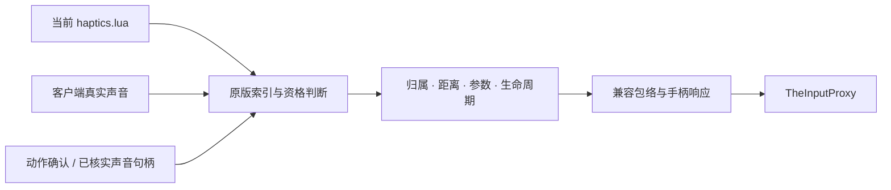

<div align="center">

# DST Haptics Compatibility

**让原版震动事件，重新连接你的手柄。**

简体中文 · [English](README.en.md)

[](https://github.com/Wuty-zju/dst-haptics-compatibility/releases/latest)
[](https://github.com/Wuty-zju/dst-haptics-compatibility/actions/workflows/ci.yml)
[](https://steamcommunity.com/sharedfiles/filedetails/?id=3805091756)
[](LICENSE)

[安装](#安装) · [功能](#功能) · [设置](#设置) · [工作原理](#工作原理) · [文档](docs/INDEX.md)

</div>

适用于 Windows《饥荒联机版》的纯客户端手柄震动兼容 Mod。读取当前游戏自带的
`haptics.lua`，将可观察的原版声音与经过审计的动作反馈送往
`TheInputProxy`；服务器和其他玩家无需安装。

> **GitHub 稳定版：[1.6.0](https://github.com/Wuty-zju/dst-haptics-compatibility/releases/tag/v1.6.0)。**
> 已核对 DST 762172 / Steam build 26474873 的 506 条定义、503 个唯一事件。
> 创意工坊版本以上传者实际更新为准；GitHub 发版不会自动更新工坊。

## 功能

| 范围 | 行为 |
|---|---|
| 原版事件 | 启动时动态建立索引，保留 category、player_only 和相对强度；不维护整套固定事件清单。 |
| 工具 | 用当前原版声音和服务器动作确认补足砍树、采矿、锤击、挖地；取消、替换动作不会借后续确认补震。 |
| 战斗与危险 | 保留可观察的挥动、命中和受击声音。近战与受击近似补偿分别可选，默认关闭。 |
| Boss 与环境 | 跟随实际可观察声音，采用监听器距离衰减；新增光束按真实具名声音句柄观察，不猜 Boss 动画。 |
| 持续声音 | 跟随播放、参数、音量、替换、停止和实体生命周期；雨声等没有 _LP 后缀的已审计循环也受管理。 |
| 手柄与设置 | Xbox/XInput、DS4、DualSense 共用事件逻辑；可细调强度、时长、设备响应与空间范围。 |

“原版表包含这个事件”不等于“远程客户端一定能观察它”。新增 14 个事件的实际来源、
服务器/客户端边界和覆盖状态见 [1.6.0 触发路径审计](docs/audit/1.6.0-trigger-paths.md)。

## 安装

### 创意工坊

1. 打开 [Steam 创意工坊项目](https://steamcommunity.com/sharedfiles/filedetails/?id=3805091756)，点击订阅。
2. 启动 DST，在客户端模组页启用本 Mod。
3. 开启原版 **控制器震动 / Controller Vibration**。

如果正在使用手工安装的同名副本，先移出游戏 `mods` 目录，避免重复加载。

### 手工安装

从 [GitHub Release](https://github.com/Wuty-zju/dst-haptics-compatibility/releases/latest)
下载具名的 `dst_haptics_compat-<版本>.zip` 与配套 `.sha256`，核对 SHA-256 后解压：

```text
Don't Starve Together/
└── mods/
    └── dst_haptics_compat/
        ├── modinfo.lua
        ├── modmain.lua
        └── scripts/
```

不要使用 GitHub 自动生成的 Source code ZIP。上传或更新工坊的方法见
[分发指南](docs/STEAM_WORKSHOP.md)。

## 设置

进入世界后按 **F8**，或使用手柄暂停菜单底部的震动设置快捷键。保存后约半秒生效，
暂停期间也可更新设置和语言。

| 设置 | 默认值 | 用途 |
|---|---|---|
| 震动兼容 | 开启 | 兼容输出总开关，仍服从原版控制器震动开关。 |
| 输出模式 | Compatibility | Compatibility / Native / Diagnostic；原生与兼容输出互斥。 |
| 语言 | 中文 | 运行时提示和日志即时切换；模组配置页保持双语。 |
| 强度、时长 | 100% | 总体与分类独立调节，0%–200%，每档 5%。 |
| 手柄类型、响应 | 自动 / Detail | 自动识别或手动指定 Xbox、DS4、DS5；可切柔和、强力和通用响应。 |
| 近战、受击近似补偿 | 均关闭 | 按复制信号估计反馈，不保证原版实际播放了对应声音；明确选择后才启用。 |
| 测试脉冲 | 关闭 | 用户主动请求弱、中、强测试；暂停时等待恢复，10 秒内未恢复则取消。 |
| 调试日志 | 关闭 | 记录事件、归属、距离、强度、参数、时长、通道和过滤原因。 |

100% 是兼容包络基准，**不是原生马达绝对强度或逐采样波形一致的承诺**。总体、原版分类、
工具/战斗/循环倍率会组合相乘；高倍率最终受马达上限限制。

### 从 1.5 升级

所有已有设置键和强度/时长数值保留。1.6 默认严格模式不再把每个 `attacked` 或
`performaction` 当成普通受击/材质命中的证据，因此某些远程战斗反馈会减少。
需要旧式补偿时分别开启近战或受击近似选项；未知护甲、远程武器和失效目标仍会保守跳过。

## 工作原理



运行时按索引、空间、设备、声音钩子、循环和动作桥分层；普通未匹配声音走 O(1) 快速旁路。
详情见 [架构](docs/ARCHITECTURE.md) 与 [测试](docs/TESTING.md)。

## 兼容范围与限制

- DS4/DS5 需要 DST 或 Steam Input 提供可用震动通道；不提供自适应扳机或 DualSense 高频触觉。
- 核心包络来自历史原版资源测量，其余按语义近似；空间衰减不是精确 FMOD attenuation。
- 部分服务器一次性声音直接由引擎复制，客户端没有可证明的 Lua 信号；不会用动画或死亡计时补造事件。
- 光束观察依赖该远程声音句柄实际可读，存在约 0.1 秒采样延迟；实机可见性尚未完整验收。
- 自动测试验证代码和原版数据，不替代 Xbox/DS4/DS5 的真实 USB、蓝牙和体感测试。

[硬件验收矩阵](docs/HARDWARE_MATRIX.md) · [证据索引](docs/maintenance/EVIDENCE.md)

## 排查与贡献

先检查原版开关、输出模式、零倍率和重复 Mod。开启调试后复现一次，查看
`Documents/Klei/DoNotStarveTogether/client_log.txt`，并附游戏版本、手柄型号、
连接方式、Steam Input 状态和配置提交 [Issue](https://github.com/Wuty-zju/dst-haptics-compatibility/issues)。

若 Klei 修复原生输出，关闭震动兼容或选择 Native。日志的机器字段和过滤原因标识保持稳定，
中文/英文的人类提示随语言设置变化。

[变更记录](CHANGELOG.md) · [开发指南](CONTRIBUTING.md) · [当前状态](docs/STATUS.md) ·
[多智能体协作](docs/maintenance/MULTI_AGENT.md) · [MIT License](LICENSE)

原创图标源位于 `assets/icon.svg`。仓库和发布包不重新分发 Klei 原始脚本或 Haptic WAV。
